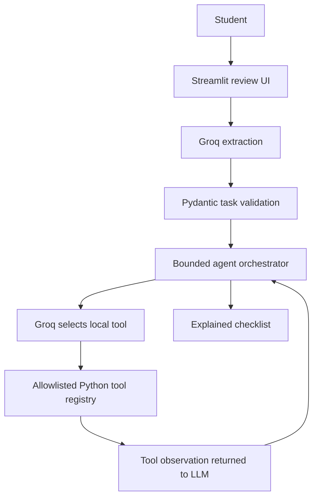

# TaskPilot

> Your AI-powered study and productivity planner.

TaskPilot turns a student’s unstructured task note into a reviewable, explained, prioritized checklist. It answers: **what should I work on first, and why?**

## Problem and users

College students often manage assignments, labs, quizzes, revision, and projects in informal notes. Deadlines and effort are easy to miss, so deciding what to start becomes difficult. TaskPilot is a lightweight planner for students who want a clear next action without a complex project-management system.

## Two development stages

| Stage | What it does |
|---|---|
| **TaskPilot Core (baseline)** | Lets users manage structured tasks and ranks them with documented Python rules. |
| **Agentic AI enhancement** | Uses Groq to extract structured tasks from natural language, lets the LLM select approved local functions, returns observations to it, and presents a concise recommendation. |

This repository implements both stages; it does not claim an earlier deployment or product existed.

## Features

- Natural-language task extraction with Groq, with Pydantic validation.
- Editable review before any planning step.
- Deterministic urgency + stated-priority scores (not LLM-invented scores).
- A bounded local tool-calling agent with `rank_tasks`, `find_missing_details`, and `format_checklist`.
- Safe allowlist, argument validation, activity trace, API error messages, and offline demo mode.
- Streamlit dashboard, tests, documentation, and PDC assessment material.

## Architecture



## Agent workflow and tools

The agent receives validated task context and three function schemas. It asks the configured model to choose a tool; Python checks both the name and Pydantic arguments; only registered functions execute locally. Tool results are sent back as observations. The loop ends when the model gives a final response or reaches `AGENT_MAX_STEPS` (default 4).

- `rank_tasks`: transparent deadline/priority ranking.
- `find_missing_details`: detects missing deadlines, estimates, and sparse descriptions.
- `format_checklist`: returns a display-friendly structured checklist.

## Stack

Python 3.11+, Streamlit, Groq Python SDK, Pydantic, python-dotenv, pytest, and Ruff.

## Install and run (macOS)

```bash
cd "/Users/macbook/Desktop/TaskPilot"
python3 -m venv .venv
source .venv/bin/activate
python -m pip install -r requirements.txt
cp .env.example .env
# Add GROQ_API_KEY to .env for live LLM extraction and tool selection.
streamlit run app.py
```

Without a key, the app works in a clearly labelled deterministic offline demo. That mode uses local rules only; it is not presented as LLM-based Agentic AI.

Run checks:

```bash
python -m pytest -q
ruff check .
```

## Example input

`Finish my DBMS assignment by tomorrow, revise Operating Systems before Friday, prepare for my DSA quiz next week, and finish my Python project this weekend.`

Expect editable extracted tasks, a tool trace, missing-detail alerts, and an ordered checklist with score and explanation.

## Limitations and future scope

Interpretation quality depends on the configured model; ambiguous dates are deliberately left blank. The first version has no persistent storage, calendar connection, authentication, reminders, or multi-user features. Future work could add user-confirmed calendars, task persistence, accessibility evaluation, and user studies.

## PDC checkpoint evidence

| Checkpoint | Evidence |
|---|---|
| Problem statement | [docs/PROBLEM_STATEMENT.md](docs/PROBLEM_STATEMENT.md) |
| GitHub consistency | `CHANGELOG.md`, `docs/DEVELOPMENT_BLOG.md`, clean source/test history going forward |
| Agentic AI/backend | [docs/AGENTIC_AI_CONCEPTS.md](docs/AGENTIC_AI_CONCEPTS.md), source and tests |
| Technical documentation/blog | [docs/ARCHITECTURE.md](docs/ARCHITECTURE.md), blog, demo, and testing records |

Screenshots should be captured from a real local run and placed in `docs/screenshots/` if required for submission; none are fabricated here.

