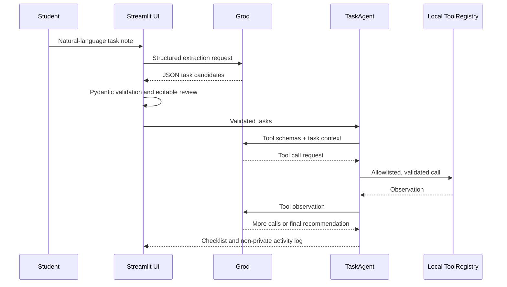

# Architecture

The UI is `app.py`. `llm_client.py` owns Groq requests. `agent.py` is the bounded orchestrator. `tools.py` is the allowlisted local registry. `models.py` validates data before execution, and `prioritization.py` owns transparent scoring. A no-key UI path uses only deterministic local code and labels itself accordingly.

